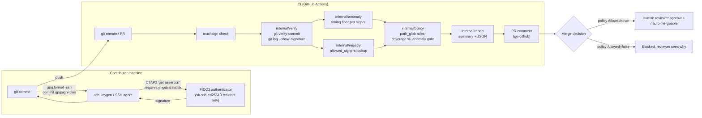

# Architecture

TouchSign is deliberately thin: it adds a verification, policy, and
anomaly-detection layer on top of mechanisms git and OpenSSH already
provide. It does not implement any part of WebAuthn, CTAP2, or FIDO2 itself.

## End-to-end flow

## Component responsibilities

- **git + OpenSSH + the FIDO2 authenticator** (nothing in this repo):
  produce and locally verify SSH commit signatures. The "a human touched a
  physical key" guarantee comes entirely from CTAP2 user-presence
  enforcement in the authenticator itself.

- **`internal/registry`**: reads/writes the `allowed_signers` file that
  `git verify-commit` consults (via `gpg.ssh.allowedSignersFile`).
  Enrollment and revocation are pull requests against this file, reviewed
  like any other change -- see the package doc comment in
  `internal/registry/registry.go`.

- **`internal/verify`**: shells out to `git verify-commit` / `git log
  --show-signature` / `git rev-list` and parses their output into
  `CommitVerification` values. This is the only place that talks to git's
  signature machinery.

- **`internal/anomaly`**: the centerpiece. Given a set of verified commits,
  flags any pair from the *same* signer whose timestamps are closer
  together than a human physically pressing a security key twice could
  plausibly produce.

- **`internal/policy`**: loads a YAML policy (`docs/policy-example.yaml`)
  and decides, given changed files + verifications + anomalies, whether the
  PR is `Allowed`.

- **`internal/report` + `cmd/touchsign`**: ties the above together into a
  CLI, prints a human summary, writes a JSON report, and (optionally) posts
  that report as a PR comment via `github.com/google/go-github/v66`.

- **`action.yml` + `Dockerfile`**: package the CLI as a Docker-based GitHub
  Action so the whole pipeline runs automatically on each PR.

## Why this shape

Every arrow in the diagram above that matters for the "was a human
physically present" guarantee is inside the "Contributor machine" box, and
none of it is code TouchSign wrote. TouchSign's own code starts only once a
signature already exists; its job is judging *what git already verified*,
not performing verification cryptography itself. See
`docs/adr/0001-why-ssh-signing-not-custom-webauthn.md` for the reasoning
behind that boundary.
